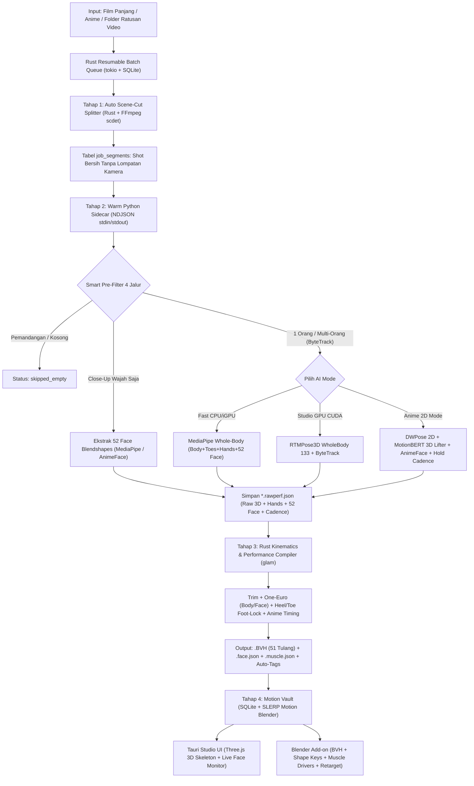

# Master Blueprint & Panduan Build: MotionHarvest Studio (Free Full Edition v1.0)

> **Status Rilis:** **100% Gratis & Lengkap Tanpa Mode Pro / Tanpa Paywall.** Seluruh fitur (*Full-Body + Kaki/Tumit/Ujung Kaki + Jari Tangan + 52 Ekspresi Wajah + Kurva Kecepatan Otot/Sendi + Multi-Person + Mode Anime 2D + Motion Blending + Auto-Retarget Blender*) digabungkan ke dalam **satu alur build v1.0** yang terstruktur bertahap dari modul terkecil hingga aplikasi siap pakai.
>
> **Stack Utama (Final):** **Tauri v2** (Backend & Kinematika **Rust**) + **React + TypeScript + Tailwind CSS + Three.js** (UI & Viewport 3D/Wajah) + **Python 3.12 (`uv`) Sidecar** (AI 3-Mode: Fast / Studio CUDA / Anime 2D) + **FFmpeg** (Auto Scene-Cut Splitter) + **SQLite** (Resumable Queue & Motion Vault) + **Blender Add-on Bridge**.

---

## 1. Gambaran Produk & Hasil Akhir yang Dituju

**MotionHarvest Studio** adalah aplikasi desktop *local-first* gratis yang memanen **performa akting karakter secara utuh** dari **video panjang (film/anime/referensi 10–120 menit)** maupun **folder berisi ratusan video pendek**, dan menyimpannya ke dalam **Katalog Gerakan & Ekspresi 3D Lokal** siap pakai di Blender, Unreal, Unity, dan Godot.

### Apa Saja Data Gerakan yang Dipanen?
1. **Gerakan Tubuh, Sendi & Kaki (`.bvh` — 21 Tulang Inti):** Tulang belakang, leher, kepala, bahu, siku, pergelangan tangan, pinggul, lutut, pergelangan kaki, **tumit (*heel*) & ujung kaki (*toe*)** lengkap dengan pengunci kontak lantai (*foot-locking*).
2. **Gerakan Jari Tangan (`.bvh` — +30 Tulang Jari, Total 51 Tulang):** 15 sendi jari tangan kiri & 15 sendi jari tangan kanan (mengepal saat marah, menunjuk, melambai, menggenggam).
3. **52 Ekspresi Wajah Standar ARKit (`.face.json`):** Tersenyum (`mouthSmile`), marah/mengernyit (`browDown`, `noseSneer`), sedih (`mouthFrown`), terkejut/bicara (`jawOpen`, `eyeWide`), berkedip (`eyeBlink`), dan lirikan mata (`eyeLook`)—langsung menggerakkan **Shape Keys** wajah di Blender/VRoid/Unreal.
4. **Kurva Tenaga Sendi & Pemicu Otot (`.muscle.json`):** Data sudut tekukan, kecepatan sudut, dan puncak hentakan tiap sendi untuk menggerakkan **Corrective Shape Keys / Pose Drivers otot tubuh** (bisep, bahu, paha) serta simulasi *physics* kain/rambut di Blender secara otomatis.
5. **Dukungan 3 Jenis Video Sumber:**
   - **Video Manusia Asli (*Live-Action*)** → Akurasi tertinggi (Body + Feet + Hands + 52 Face).
   - **Video Animasi 3D (Game / CGI / Film 3D)** → Akurasi tinggi untuk tubuh, jari, kaki, dan ekspresi wajah utama.
   - **Video Animasi 2D (Anime / Kartun 2D)** → Menggunakan **Anime 2D Pipeline khusus** (`DWPose/RTMPose-WholeBody` + `MotionBERT 2D→3D Lifter` + `Anime Face Estimator` + ekstraksi pola *hold-frame* asli anime).

### Tata Letak UI Hasil Akhir (Dark Pro Studio)

```text
+--------------------------------------------------------------------------------------+
| [MotionHarvest Studio]  [+ Video] [+ Folder]    [Blender: Terhubung ●]   [⚙ Setelan] |
+-----------------------+----------------------------------------+---------------------+
|  1. HARVEST QUEUE     |       2. 3D VIEWPORT & FACE MONITOR    |  3. MOTION POLISH   |
|  -------------------  |  +--------------------------+--------+ |  -----------------  |
|  ▶ anime_ep04.mkv     |  |         \  O  /          | FACE   | |  Smoothing   [==•=] |
|    [████░░] 64%       |  |          \ | /           | 😊 82% | |  Face Smooth [===•] |
|    18/28 shots        |  |            |             | 😠 05% | |  Foot Lock   [ ON ] |
|    (5 face, 4 skip)   |  |           / \            | 👁 Blink| |  Include:           |
|                       |  |    ------/---\------     | 👄 Open| |  [☑] Jari [☑] Wajah |
|  ⏸ folder_akting/     |  |     (Grid 3D Blender)    +--------+ |  [☑] Muscle Drivers |
|    42 video antre     |  +-----------------------------------+ |                     |
|                       |  [▶] 00:02.4 / 00:08.0 [0.5x][1x][⟳]  |  Timing Preset:     |
|  [Start][Pause][Stop] |  |--[◄========|==========►]--| Trim    |  ( ) Smooth Ori FPS |
|                       |                                        |  (•) Anime 12 FPS   |
|  Konfigurasi Panen:   |  [Tab: Preview Klip] [Tab: Blend Klip] |  ( ) Ghibli 8 FPS   |
|  Mode [Anime 2D   ▾]  |  (Gabung: Walk -> Jump -> Senyum)      |  ( ) Ori Hold-Frame |
|  Multi-Orang [ ON ]   |                                        |                     |
|  Scene Cut  [==•==]   |                                        |  Retarget [VRoid ▾] |
|                       |                                        |  [Kirim ke Blender] |
|                       |                                        |  [Export Bundle]    |
+-----------------------+----------------------------------------+---------------------+
|  4. MOTION VAULT (168 Klip)  🔍 [Cari...]  Tipe:[All][Body][Face][Blend]             |
|  Tag: [Walk][Run][Jump][Sit][Action] | Emosi: [😊Happy][😠Angry][😢Sad][😮Talk] [★] |
|  Koleksi: [Semua ▾]   [☑ Pilih Banyak -> Gabung (Blend) / Batch Export / Hapus]      |
|  [ 🏃 Lari+Kepal 4.2s ★94% ] [ 😊 Senyum CloseUp 3.1s ★96% ] [ 🤸 Lompat 2.8s ★89% ] |
+--------------------------------------------------------------------------------------+
```

### Skenario Nyata Saat Aplikasi Sudah Jadi
1. **Panen Film Panjang / Episode Anime / Folder Video:** Pengguna menyeret 1 video panjang (atau 1 folder berisi 100 klip), memilih mode (`Fast CPU/iGPU`, `Studio GPU CUDA`, atau `Anime 2D`), mengaktifkan **Multi-Orang**, lalu klik **Start**.
   - FFmpeg memotong otomatis di setiap ganti kamera.
   - **Pre-Filter 4 Jalur** otomatis memilah: adegan badan penuh → panen **Body + Kaki + Jari + Wajah + Otot**; adegan *close-up* wajah → **tidak dibuang**, justru dipanen sebagai **Klip Ekspresi Wajah**; adegan banyak orang → dipisah per karakter (`Person #1`, `Person #2`); adegan pemandangan kosong → langsung di-*skip*.
2. **Poles & Gabung Gerakan Secara Instan (Rust `< 15 ms`):** Pengguna membuka klip di **Viewport 3D** (kerangka 51 tulang + monitor 52 ekspresi wajah), memotong awal/akhir (*Trim*), menyalakan **Foot Lock**, mengatur *Smoothing*, dan memilih **Anime 12 FPS** atau **Ori Hold-Frame**. Pengguna juga bisa memilih 2–3 klip di Vault lalu klik **Gabung (Blend)** untuk menyatukan `Jalan -> Berhenti -> Tersenyum` secara mulus memakai SLERP Quaternion.
3. **Kirim ke Blender 1 Klik:** Pengguna memilih target rig (**Raw BVH**, **Mixamo**, **Rigify**, atau **VRoid/Anime 3D**) lalu klik **Kirim ke Blender** → tulang tubuh + jari, *Shape Keys* ekspresi wajah, kurva pemicu otot, dan *stepped keyframes* langsung terpasang di *scene* Blender!

---

## 2. Matriks Ketertelusuran Fitur (Jaminan 100% Fitur Terpakai)

| Elemen UI / Fitur | Tauri IPC Command / Event | Proses Backend (Rust / Python / FFmpeg) | Efek Nyata ke Data / Output |
| :--- | :--- | :--- | :--- |
| **+ Video / + Folder / Drag-Drop** | `enqueue_sources(paths, config)` | Pindai `.mp4/.mkv/.mov/.avi/.webm`, simpan ke `batch_jobs` | Job masuk antrean kiri status `queued` |
| **Pilihan Mode AI (`Fast` / `Studio CUDA` / `Anime 2D`)** | `batch_jobs.ai_mode` | Diteruskan ke `worker.py` memilih backend (`mediapipe` / `cuda_studio` / `anime_2d`) | Menentukan model pose tubuh, jari, & wajah yang dipakai |
| **Toggle Multi-Orang (`multi_person`)** | `batch_jobs.config_json` | Mengaktifkan `YOLO + ByteTrack` di `worker.py` untuk memecah subjek per `track_id` | 1 adegan berisi 3 orang otomatis menghasilkan 3 klip bersih terpisah |
| **Slider Scene-Cut & Min/Max Durasi** | `batch_jobs.config_json` | Dipakai `splitter.rs` (`ffmpeg -vf scdet=threshold=...`) | Mengontrol sensitivitas & panjang segmen potongan kamera |
| **Pre-Filter 4 Jalur** | Event `segment:classified` | `prefilter.py` mengklasifikasi: `full_performance`, `face_closeup`, `multi_person`, `skipped_empty` | Adegan kosong dibuang; *close-up* wajah dipanen ke katalog Face |
| **Start / Pause / Resume / Cancel** | `queue_control(action, job_id)` + `queue:updated` | Mengendalikan `tokio` worker & menyimpan progres di `job_segments` | Aman tutup aplikasi / mati lampu; lanjut tepat di segmen terakhir |
| **Viewport 3D (51 Tulang + Monitor Wajah)** | `get_clip_preview(clip_id)` | Memuat `.bvh` ke `Three.js` + frame `.face.json` ke panel 52 bar & wajah 3D mini | Memutar tubuh, tumit/ujung kaki, jari, dan ekspresi wajah sinkron |
| **Trim Handles (Start / End Frame)** | `recompile_clip(clip_id, polish_cfg)` | Rust memotong frame dari `*.rawperf.json` → kompilasi ulang `.bvh`, `.face.json`, `.muscle.json` | Klip terpotong non-destruktif; durasi di SQLite ikut berubah |
| **Smoothing (Body & Face) + Foot Lock** | `recompile_clip(clip_id, polish_cfg)` | Rust jalankan `OneEuroFilter` (sendi + 52 wajah) & `FootLocker` (`Heel` + `Toe`) | Hilangkan getaran tubuh/wajah & kaki meluncur dalam `< 15 ms` |
| **Toggle Include Jari / Wajah / Muscle** | `polish_config_json` | Mengatur apakah tulang jari (30 tulang), `.face.json`, dan `.muscle.json` disertakan saat ekspor | Fleksibel untuk rig sederhana (21 tulang) maupun lengkap (51 tulang) |
| **Timing (`Smooth` / `Anime 12` / `Ghibli 8` / `Ori Hold`)** | `recompile_clip(clip_id, polish_cfg)` | Rust jalankan `anime_timing.rs` pada kurva tubuh, jari, dan wajah secara serentak | Animasi langsung berubah ke ritme *On Twos*, *On Threes*, atau *Hold* asli anime |
| **Tab Blend Klip (Motion Sequencer)** | `blend_clips(clip_ids, transition_frames, name)` | Rust `blender_slerp.rs` menyambung beberapa klip dengan SLERP Quaternion + lintas-pudar wajah | Menghasilkan klip gabungan baru di Vault (`clip_type = 'blended'`) |
| **Search, Tipe Klip, Tag Gerak, Tag Emosi, Favorit, Koleksi** | `query_vault(filter)`, `toggle_favorite`, `manage_collections` | Query SQLite `motion_clips` (`clip_type`, `body_tags`, `emotion_tags`, `collection_id`) | Menemukan gerakan atau emosi spesifik dari ribuan klip secara instan |
| **Export Bundle & Batch Export** | `export_clips(clip_ids, target_dir)` | Menyalin `.bvh` + `.face.json` + `.muscle.json` ke folder tujuan | Siap impor ke Blender / Unreal / Unity / Godot |
| **Retarget Preset + Kirim ke Blender** | `ping_blender()`, `send_to_blender(clip_id, opts)` | HTTP lokal ke `127.0.0.1:9877` (Add-on Blender) | Memasang tulang `.bvh` + Auto-Retarget + 52 Shape Keys + Muscle Drivers + Stepped F-Curves |
| **First-Run Model Manager & Setelan** | `check_models()`, `download_models()`, `save_settings()` | Mengunduh bobot AI sekali ke `<VaultDir>/models/` & simpan `app_settings` | Aplikasi ringan saat diinstal; model siap pakai offline selamanya |

---

## 3. Arsitektur Sistem & Alur Pipeline Lengkap



---

## 4. Step 0: Prasyarat & Setup Environment di PC Target (High-Spec)

Instal dan pastikan semua komponen berikut tersedia di PC target:
1. **Rust Toolchain:** [rustup.rs](https://rustup.rs) (`stable-x86_64-pc-windows-msvc`).
2. **Visual Studio 2022 Build Tools:** Centang workload **"Desktop development with C++"**.
3. **WebView2 Runtime:** Bawaan Windows 11 (instal manual jika Windows 10).
4. **Node.js (v20+ LTS) & `pnpm`:** `corepack enable` atau `npm i -g pnpm`.
5. **Python 3.12 & `uv`:** `powershell -ExecutionPolicy ByPass -c "irm https://astral.sh/uv/install.ps1 | iex"`.
6. **FFmpeg & FFprobe (Full Build):** Terdaftar di System `PATH` (mendukung filter `scdet` & opsional `h264_nvenc`).
7. **Driver GPU NVIDIA + CUDA (Sangat disarankan di PC target):** Untuk menjalankan `Studio CUDA` & `Anime 2D (MotionBERT)` dengan kecepatan maksimal.
8. **Blender 4.0+:** Untuk menguji *Blender Add-on Bridge* lengkap.

### Verifikasi Cepat di PowerShell PC Target
```powershell
rustc --version; cargo --version; node --version; pnpm --version
python --version; uv --version
ffmpeg -version | Select-Object -First 1
ffprobe -version | Select-Object -First 1
nvidia-smi
```

---

## 5. Struktur Direktori Proyek Lengkap

```text
motion-harvest/
├── package.json                          # Script frontend, Three.js & Tauri CLI
├── tsconfig.json
├── vite.config.ts
├── tailwind.config.js
├── index.html
│
├── src/                                  # [FRONTEND] React + TypeScript + Three.js
│   ├── main.tsx
│   ├── App.tsx                           # Layout 3-Panel Studio + Bottom Vault + State
│   ├── types/
│   │   └── motion.ts                     # Tipe TS identik dengan Rust IPC
│   ├── lib/
│   │   └── api.ts                        # Wrapper terketik untuk invoke() & listen()
│   └── components/
│       ├── TopBar.tsx                    # +Video, +Folder, Status Blender, Model Status, Setelan
│       ├── HarvestQueuePanel.tsx         # Panel Kiri: Drag-Drop, Mode AI, Multi-Orang, Pause/Resume
│       ├── Viewport3D.tsx                # Panel Tengah: Three.js 51 Tulang + Timeline + Trim Handles
│       ├── FaceMonitorWidget.tsx         # Monitor Mini 52 Ekspresi Wajah (Bars + Emosi Aktif)
│       ├── MotionBlendTab.tsx            # Tab Sequencer: Gabung 2-5 klip (SLERP Blend)
│       ├── MotionPolishPanel.tsx         # Panel Kanan: Smoothing Body/Face, Foot-Lock, Timing, Retarget, Export
│       ├── MotionVaultPanel.tsx          # Panel Bawah: Search, Filter Tipe/Gerak/Emosi/Koleksi, Batch Export
│       ├── ModelSetupModal.tsx           # Wizard unduh otomatis bobot model AI (Gratis/First-Run)
│       └── SettingsModal.tsx             # Vault Path, Port Blender, Default AI Engine, Hardware Decode
│
├── src-tauri/                            # [BACKEND CORE] 100% Rust + Tauri v2
│   ├── Cargo.toml
│   ├── tauri.conf.json
│   ├── capabilities/
│   │   └── default.json
│   └── src/
│       ├── main.rs
│       ├── lib.rs                        # Setup state, DB, recovery, sidecar, dan Tauri commands
│       ├── models.rs                     # Struct bersama (Job, Segment, Clip, RawPerf, PolishConfig)
│       ├── db.rs                         # SQLite WAL, skema lengkap, CRUD & query filter
│       ├── commands.rs                   # Semua #[tauri::command]
│       ├── model_manager.rs              # Cek & unduh bobot AI (MediaPipe, DWPose, MotionBERT) dengan progress
│       ├── blender_bridge.rs             # Client HTTP lokal ke 127.0.0.1:9877
│       ├── pipeline/
│       │   ├── mod.rs
│       │   ├── splitter.rs               # FFprobe + FFmpeg scdet & potong segmen
│       │   ├── sidecar.rs                # Warm worker Python persisten (NDJSON stdin/stdout)
│       │   └── queue.rs                  # Background tokio worker (Multi-person, Pause/Resume/Recovery)
│       └── kinematics/
│           ├── mod.rs                    # Orkestrator: RawPerf -> Trim -> Polish -> BVH + Face + Muscle + Tags
│           ├── skeleton.rs               # Hirarki 51 tulang (21 Body+Heel/Toe + 30 Jari) & rest pose
│           ├── one_euro.rs               # One-Euro Filter untuk sendi 3D & 52 facial blendshapes
│           ├── foot_lock.rs              # Pengunci kontak lantai untuk Heel + Toe kiri/kanan
│           ├── anime_timing.rs           # Quantizer Smooth / Anime 12 / Ghibli 8 / Original Hold-Frame
│           ├── bvh_writer.rs             # Quaternion -> Euler ZXY & serializer .bvh (21 atau 51 tulang)
│           ├── muscle_curves.rs          # Kalkulator sudut tekukan, kecepatan sudut & puncak impact sendi
│           ├── auto_tagger.rs            # Auto-tagger Gerakan Tubuh + Auto-tagger Emosi Wajah
│           └── motion_blender.rs         # Penggabung multi-klip memakai SLERP Quaternion + crossfade wajah
│
├── sidecar-pose/                         # [AI ENGINE] Python 3.12 terisolasi via uv
│   ├── pyproject.toml                    # Dependencies inti + optional [cuda]
│   ├── worker.py                         # Warm worker NDJSON loop
│   ├── prefilter.py                      # Smart Pre-Filter 4 Jalur (Full / FaceCloseUp / MultiPerson / Skip)
│   ├── tracker.py                        # Multi-person detector & tracker (YOLO + ByteTrack)
│   ├── cadence.py                        # Detektor frame duplikat / pola hold-frame asli anime 2D
│   └── backends/
│       ├── base.py                       # Abstract interface PerformanceBackend
│       ├── mediapipe_backend.py          # Fast Mode: Pose (33) + Hands (21x2) + Face (52 ARKit)
│       ├── cuda_studio_backend.py        # Studio CUDA Mode: RTMPose3D WholeBody 133 + Face Blendshapes
│       └── anime_2d_backend.py           # Anime 2D Mode: DWPose 2D + MotionBERT 2D->3D + AnimeFace Mapper
│
└── blender-addon/                        # [BLENDER INTEGRATION]
    └── motion_harvest_bridge.py          # Add-on Blender 4.x: Impor BVH + 52 Shape Keys + Muscle Drivers + Retarget
```

---

## 6. Kontrak Data & Protokol Komunikasi (*Single Source of Truth*)

### 6.1 Skema Database SQLite (`src-tauri/src/db.rs`)

```sql
PRAGMA journal_mode = WAL;
PRAGMA foreign_keys = ON;

CREATE TABLE IF NOT EXISTS app_settings (
    key TEXT PRIMARY KEY,
    value TEXT NOT NULL
);
-- Keys: vault_dir, blender_port ("9877"), default_ai_mode ("fast"), scene_threshold ("12.0"), use_nvenc ("auto")

CREATE TABLE IF NOT EXISTS collections (
    id TEXT PRIMARY KEY,
    name TEXT NOT NULL UNIQUE,
    created_at TEXT NOT NULL
);

CREATE TABLE IF NOT EXISTS batch_jobs (
    id TEXT PRIMARY KEY,
    source_path TEXT NOT NULL,
    source_name TEXT NOT NULL,
    source_duration_sec REAL NOT NULL DEFAULT 0,
    ai_mode TEXT NOT NULL DEFAULT 'fast',          -- 'fast' | 'studio_cuda' | 'anime_2d'
    config_json TEXT NOT NULL,                     -- { scene_threshold, min_clip_sec, max_clip_sec, min_visibility, multi_person, max_persons }
    status TEXT NOT NULL DEFAULT 'queued',         -- 'queued' | 'splitting' | 'processing' | 'paused' | 'completed' | 'cancelled' | 'failed'
    total_segments INTEGER NOT NULL DEFAULT 0,
    done_segments INTEGER NOT NULL DEFAULT 0,
    face_segments INTEGER NOT NULL DEFAULT 0,
    skipped_segments INTEGER NOT NULL DEFAULT 0,
    error_message TEXT,
    created_at TEXT NOT NULL,
    updated_at TEXT NOT NULL
);

CREATE TABLE IF NOT EXISTS job_segments (
    id TEXT PRIMARY KEY,
    job_id TEXT NOT NULL REFERENCES batch_jobs(id) ON DELETE CASCADE,
    segment_index INTEGER NOT NULL,
    start_sec REAL NOT NULL,
    end_sec REAL NOT NULL,
    temp_video_path TEXT,
    detected_class TEXT,                           -- 'full_performance' | 'face_closeup' | 'multi_person' | 'skipped_empty'
    status TEXT NOT NULL DEFAULT 'pending',        -- 'pending' | 'extracting' | 'completed' | 'skipped' | 'failed'
    error_message TEXT
);

CREATE TABLE IF NOT EXISTS motion_clips (
    id TEXT PRIMARY KEY,
    job_id TEXT REFERENCES batch_jobs(id) ON DELETE SET NULL,
    collection_id TEXT REFERENCES collections(id) ON DELETE SET NULL,
    clip_type TEXT NOT NULL DEFAULT 'full_body',   -- 'full_body' | 'face_only' | 'blended'
    person_track_id INTEGER NOT NULL DEFAULT 0,    -- Pembeda jika 1 segmen memiliki beberapa orang
    title TEXT NOT NULL,
    source_video TEXT NOT NULL,
    source_start_sec REAL NOT NULL,
    source_end_sec REAL NOT NULL,
    fps REAL NOT NULL,
    total_raw_frames INTEGER NOT NULL,
    frame_count INTEGER NOT NULL,
    duration_sec REAL NOT NULL,
    quality_score REAL NOT NULL,                   -- 0.0 - 1.0
    has_hands INTEGER NOT NULL DEFAULT 0,
    has_face INTEGER NOT NULL DEFAULT 0,
    body_tags TEXT NOT NULL DEFAULT '[]',          -- JSON array: ["run","jump","action"]
    emotion_tags TEXT NOT NULL DEFAULT '[]',       -- JSON array: ["happy","angry","talking"]
    is_favorite INTEGER NOT NULL DEFAULT 0,
    raw_perf_path TEXT NOT NULL,                   -- Menyimpan data mentah Body+Hands+52 Face+Cadence
    bvh_path TEXT,                                 -- NULL jika clip_type = 'face_only'
    face_path TEXT,                                -- File .face.json terpoles
    muscle_path TEXT,                              -- File .muscle.json (joint velocity & impact curves)
    polish_config_json TEXT NOT NULL,              -- { body_smooth, face_smooth, foot_lock, include_hands, include_face, include_muscle, timing_mode, trim_start, trim_end }
    created_at TEXT NOT NULL
);
```

### 6.2 Format File `*.rawperf.json` (Data Performa Mentah untuk Re-Polish `< 15 ms`)

Satu file mentah menyimpan seluruh kanal performa per *track* subjek agar Rust bisa mengompilasi ulang `.bvh`, `.face.json`, dan `.muscle.json` kapan saja tanpa menjalankan ulang AI:

```json
{
  "fps": 24.0,
  "clip_type": "full_body",
  "source_mode": "anime_2d",
  "person_track_id": 1,
  "anime_hold_indices": [0, 0, 2, 2, 2, 5, 5],
  "frames": [
    {
      "t": 0.0,
      "root_pos": [0.02, 0.94, 0.0],
      "body_joints": [[0.0, 0.52, -0.04, 0.98], "... (33 joint: termasuk Ankle, Heel, FootIndex)"],
      "left_hand": [[0.0, 0.0, 0.0, 0.95], "... (21 joint jari kiri atau null)"],
      "right_hand": [[0.0, 0.0, 0.0, 0.94], "... (21 joint jari kanan atau null)"],
      "face_blendshapes": {
        "mouthSmileLeft": 0.78,
        "mouthSmileRight": 0.81,
        "browDownLeft": 0.04,
        "eyeBlinkLeft": 0.12,
        "jawOpen": 0.35
      }
    }
  ]
}
```

### 6.3 Protokol NDJSON `Rust <-> Python Sidecar`

- **Request (`stdin`):**
  ```json
  {
    "cmd": "extract",
    "segment_id": "seg_001",
    "video_path": "D:/Vault/temp/seg_001.mp4",
    "ai_mode": "anime_2d",
    "multi_person": true,
    "max_persons": 4,
    "min_visibility": 0.50,
    "output_dir": "D:/Vault/raw",
    "models_dir": "D:/Vault/models"
  }
  ```
- **Response (`stdout` — streaming per baris):**
  ```json
  {"event": "classified", "segment_id": "seg_001", "class": "multi_person", "person_count": 2}
  {"event": "progress", "segment_id": "seg_001", "current_frame": 60, "total_frames": 180}
  {"event": "track_completed", "segment_id": "seg_001", "person_track_id": 1, "clip_type": "full_body", "fps": 24.0, "frame_count": 180, "quality_score": 0.89, "has_hands": true, "has_face": true, "raw_perf_path": "D:/Vault/raw/seg_001_p1.rawperf.json"}
  {"event": "segment_done", "segment_id": "seg_001", "tracks_produced": 2}
  ```

### 6.4 Protokol `MotionHarvest Studio -> Blender Add-on` (`127.0.0.1:9877`)

- `GET /ping` → `{"ok": true, "blender_version": "4.2.0", "selected_armature": "VRoid_Girl"}`
- `POST /import_performance`:
  ```json
  {
    "clip_name": "Lari_Senyum_01",
    "bvh_path": "D:/Vault/bvh/clip_01.bvh",
    "face_path": "D:/Vault/face/clip_01.face.json",
    "muscle_path": "D:/Vault/muscle/clip_01.muscle.json",
    "retarget_preset": "vroid",
    "global_scale": 1.0,
    "stepped_anime": true,
    "apply_muscle_drivers": true
  }
  ```

---

## 7. Alur Pembuatan Step-by-Step (Terurut dari Terkecil ke Utuh)

Seluruh fitur dibagi menjadi **11 langkah kecil yang berurutan**. Setiap langkah memiliki **Kriteria Lulus** wajib sebelum berlanjut ke langkah berikutnya.

---

### Step 1: Scaffolding Tauri v2 + React + Tailwind + Three.js
**Tujuan:** Jendela aplikasi desktop kosong berjalan stabil di PC target.

1. Inisialisasi proyek:
   ```powershell
   pnpm create tauri-app motion-harvest --template react-ts --manager pnpm
   cd motion-harvest
   pnpm add tailwindcss @tailwindcss/vite lucide-react three @types/three
   pnpm add @tauri-apps/plugin-dialog @tauri-apps/plugin-fs
   ```
2. Tambahkan crate Rust di `src-tauri/Cargo.toml`: `tauri`, `tauri-plugin-dialog`, `tauri-plugin-fs`, `tokio` (`full`), `serde` (`derive`), `serde_json`, `rusqlite` (`bundled`), `glam` (`serde`), `uuid` (`v4`), `chrono` (`serde`), `regex`, `reqwest` (`json`, `stream`), `futures-util`, `thiserror`.
3. Konfigurasi izin file/folder dialog & event di `src-tauri/capabilities/default.json`.

**Kriteria Lulus Step 1:** `pnpm tauri dev` membuka jendela aplikasi tanpa error kompilasi Rust maupun TypeScript.

---

### Step 2: Fondasi Database SQLite, Struktur Vault & Model Manager
**Tujuan:** Penyimpanan permanen `<VaultDir>/vault.db`, folder `raw/`, `bvh/`, `face/`, `muscle/`, `models/`, `temp/`, serta pengunduh bobot AI gratis saat *first-run*.

1. Implementasikan `src-tauri/src/models.rs` dan `src-tauri/src/db.rs` dengan seluruh tabel pada Bagian 6.1.
2. Implementasikan `recover_interrupted_jobs()` saat aplikasi dibuka (mengembalikan job `splitting/processing` ke `paused` dan segmen `extracting` ke `pending`).
3. Implementasikan `src-tauri/src/model_manager.rs` untuk mengecek ketersediaan file model di `<VaultDir>/models/` dan mengunduhnya secara asinkron dengan event progress ke UI (`model:download_progress`) tanpa perlu instalasi manual oleh pengguna.

**Kriteria Lulus Step 2:** `cargo test db::tests` lulus 100% (CRUD, filter kombinasi `clip_type + body_tags + emotion_tags`, dan recovery antrean).

---

### Step 3: Auto Scene-Cut Splitter (`src-tauri/src/pipeline/splitter.rs`)
**Tujuan:** Memecah video film/anime panjang di setiap ganti kamera dan menormalisasi durasi potongan.

1. Baca durasi & FPS lewat `ffprobe -v error -show_entries format=duration -show_entries stream=r_frame_rate -of json <video>`.
2. Deteksi *scene cuts* lewat `ffmpeg -i <video> -vf "scdet=threshold=<scene_threshold>" -an -f null -` dan parsing `lavfi.scd.time:<sec>`.
3. Buang segmen `< min_clip_sec` (default `1.2s`); pecah segmen `> max_clip_sec` (default `20.0s`) menjadi potongan blok rapi.
4. Potong segmen sementara ke `<VaultDir>/temp/` dengan `libx264 -preset ultrafast` (atau `h264_nvenc` jika GPU NVIDIA tersedia & aktif di setelan).

**Kriteria Lulus Step 3:** Tes otomatis membuat video 12 detik (3 adegan warna berbeda tiap 4 detik) → `splitter.rs` menghasilkan tepat 3 baris di `job_segments`.

---

### Step 4: Python Sidecar — Jalur Live-Action & Animasi 3D + Multi-Orang (`sidecar-pose/`)
**Tujuan:** Membangun fondasi *warm worker* Python, **Pre-Filter 4 Jalur**, **Fast Mode (MediaPipe Whole-Body)**, dan **Studio CUDA Mode (RTMPose3D + Multi-Person ByteTrack)**.

1. Inisialisasi `uv` di `sidecar-pose/`:
   ```powershell
   cd sidecar-pose
   uv init --python 3.12
   uv add mediapipe opencv-python-headless numpy onnxruntime
   ```
   Tambahkan extra `[cuda]` di `pyproject.toml`: `torch`, `onnxruntime-gpu`, `ultralytics` (untuk deteksi orang & `ByteTrack` multi-person).
2. **`prefilter.py` (Smart Pre-Filter 4 Jalur):**
   - Sampel 5 frame merata per segmen (`15%, 35%, 50%, 65%, 85%`):
     - Deteksi jumlah kotak tubuh manusia + detektor wajah.
     - Jika ada `>= 2` orang jelas dan `multi_person == True` → `multi_person`.
     - Jika ada `1` orang dengan pinggul + bahu/lutut terlihat (`visibility >= min_visibility`) → `full_performance`.
     - Jika tubuh tidak utuh, **tetapi wajah terlihat jelas (lebar wajah ≥ 12% lebar frame)** → `face_closeup` (**TIDAK DI-SKIP!**).
     - Selain itu → `skipped_empty`.
3. **`tracker.py` (Multi-Person Splitter):**
   - Pada kelas `multi_person`, jalankan `YOLO + ByteTrack` untuk menghasilkan *bounding box* konsisten per `track_id` (maksimal `max_persons` orang terbesar/terjelas). Setiap orang dipotong (*crop* dengan padding 20%) dan diekstrak menjadi `*.rawperf.json` terpisah!
4. **`backends/mediapipe_backend.py` (Fast Mode):**
   - Menjalankan `PoseLandmarker` (33 titik 3D termasuk `Heel` & `FootIndex`), `HandLandmarker` (21×2 jari), dan `FaceLandmarker` (`output_face_blendshapes=True` → 52 ARKit blendshapes) dalam satu pass frame.
   - Jika kelasnya `face_closeup`, hanya menjalankan `FaceLandmarker` (super cepat!).
5. **`backends/cuda_studio_backend.py` (Studio GPU CUDA Mode):**
   - Menjalankan **RTMPose3D WholeBody 133** via `onnxruntime-gpu` (CUDA Execution Provider) untuk akurasi tubuh, kaki/ujung kaki, dan jari tingkat studio, dipadukan dengan ekstraksi 52 ARKit blendshapes pada *crop* wajah.

**Kriteria Lulus Step 4:** Uji CLI `worker.py` dengan 4 video uji:
- Video 1 orang penuh → menghasilkan `rawperf.json` lengkap (Body + Toes + Hands + 52 Face).
- Video 2 orang → menghasilkan 2 file `rawperf.json` (`person_track_id: 1` dan `2`).
- Video *close-up* orang tersenyum/marah → menghasilkan `clip_type: "face_only"` dengan nilai `mouthSmile` / `browDown` tinggi.
- Video pemandangan kosong → langsung mengembalikan `skipped_empty` dalam `< 0.5 detik`.

---

### Step 5: Python Sidecar — Jalur Khusus Anime 2D (`anime_2d_backend.py` & `cadence.py`)
**Tujuan:** Membuat ekstraksi dari video **Anime / Kartun 2D** jauh lebih akurat dan mempertahankan keunikan ritme animasi 2D.

1. **`cadence.py` (Detektor Pola *Hold-Frame* Asli Anime):**
   - Menghitung perbedaan piksel rata-rata (*MAD / SSIM*) antar frame berurutan pada area karakter.
   - Jika perbedaan `< ambang` (frame kembar karena anime digambar *On Twos* atau *On Threes*), mencatat indeks frame unik sebelumnya ke array `anime_hold_indices` (misal `[0, 0, 2, 2, 2, 5, 5]`).
   - Manfaat ganda: (1) AI hanya perlu memproses frame unik (2–3x lebih cepat!), dan (2) Rust bisa meniru persis ritme *hold-frame* asli animator anime saat opsi **Original Hold-Frame** dipilih!
2. **`backends/anime_2d_backend.py` (2-Stage Pipeline Anime 2D):**
   - **Stage A — Deteksi 2D Ramah Anime:** Menggunakan **DWPose / RTMPose-WholeBody (ONNX)** yang sangat tangguh terhadap garis gambar 2D, rambut mencolok, dan pakaian longgar anime untuk mengekstrak 133 titik 2D (tubuh + kaki + jari + 68 titik wajah).
   - **Stage B — Temporal 2D-to-3D Lifter (`MotionBERT` ONNX/PyTorch):** Mengangkat urutan 2D seluruh segmen sekaligus (jendela temporal 81–243 frame) menjadi koordinat 3D yang konsisten secara anatomi tanpa *flipping* kiri/kanan.
   - **Stage C — Anime Face Mapper:** Menghitung rasio geometris dari 68 titik wajah anime (tinggi kelopak mata → `eyeBlinkLeft/Right`, bukaan mulut → `jawOpen`, kelengkungan sudut bibir → `mouthSmile` / `mouthFrown`, kemiringan sudut alis ke dalam → `browDownLeft/Right` untuk ekspresi marah) lalu memetakannya ke format **52 ARKit Blendshapes** yang sama!

**Kriteria Lulus Step 5:** Uji `worker.py` dengan mode `anime_2d` pada klip anime 2D → menghasilkan `rawperf.json` lengkap dengan `anime_hold_indices` non-kosong, postur 3D stabil, dan kurva mata/mulut/alis terbaca.

---

### Step 6: Mesin Kinematika 3D, Wajah, Muscle Curves & Motion Blender Murni Rust (`src-tauri/src/kinematics/`)
**Tujuan:** Seluruh matematika berat berjalan super cepat di Rust (`< 15 ms` per re-compile) sehingga UI terasa instan.

1. **`skeleton.rs` (Hirarki 51 Tulang Standar):**
   - **21 Tulang Inti Body + Kaki:** `Hips -> Spine -> Chest -> Neck -> Head`, `Left/RightShoulder -> UpperArm -> LowerArm -> Hand`, `Left/RightUpperLeg -> LowerLeg -> Foot -> Toe` (menggunakan `Ankle -> Heel/FootIndex` untuk rotasi engkel & jinjit jari kaki!).
   - **+30 Tulang Jari (Opsional via `include_hands`):** 3 ruas × 5 jari × 2 tangan (`Thumb1..3`, `Index1..3`, `Middle1..3`, `Ring1..3`, `Pinky1..3`).
2. **`one_euro.rs`:** *Adaptive Smoothing* terpisah untuk `body_smooth` (koordinat 3D sendi & jari) dan `face_smooth` (52 nilai blendshape agar ekspresi tidak kedip-kedip liar).
3. **`foot_lock.rs` (Heel + Toe Ground Contact Lock):**
   - Mengukur tinggi lantai `ground_y` dari persentil ke-5 titik terendah `Heel` dan `Toe`.
   - Mengunci pergeseran horizontal X/Z saat tumit *atau* ujung kaki menapak (`y < ground_y + 0.04m` dan kecepatan `< 0.15 m/s`) dengan transisi *ease-in/out* 3 frame agar langkah terlihat berbobot.
4. **`anime_timing.rs`:**
   - Mendukung 4 mode: `Smooth`, `Anime12` (*On Twos*), `Ghibli8` (*On Threes*), dan `OriginalHold` (menggunakan `anime_hold_indices` hasil deteksi `cadence.py`). Diterapkan serempak pada tubuh, jari, dan ekspresi wajah!
5. **`bvh_writer.rs`:** Menghitung orientasi global `Hips` dan rotasi lokal anak (`glam::Quat::from_rotation_arc` + *twist alignment*) → konversi ke `EulerRot::ZXY` derajat → tulis `.bvh` valid (21 atau 51 tulang).
6. **`muscle_curves.rs` (Pemicu Otot & Secondary Physics):**
   - Menghitung per frame: sudut tekukan sendi utama (`left_elbow_flex`, `right_elbow_flex`, `left_knee_flex`, `right_knee_flex`, `shoulder_raise_l/r`), kecepatan sudut (`angular_velocity`), dan sinyal puncak hentakan (`impact_spike` saat mendarat atau memukul) → simpan ke `.muscle.json` (nilai ternormalisasi `0.0–1.0` siap dihubungkan ke *Corrective Shape Keys / Drivers* di Blender!).
7. **`auto_tagger.rs` (Auto-Tagger Tubuh + Emosi Wajah):**
   - **Body Tags:** `idle`, `walk`, `run`, `jump`, `sit_crouch`, `gesture`, `action` (berdasarkan kecepatan pinggul, lompatan kaki, sudut lutut, ayunan tangan).
   - **Emotion Tags (dari 52 ARKit Blendshapes):**
     - `mouthSmileLeft+Right > 0.45` → `happy`
     - `browDownLeft+Right > 0.40` → `angry`
     - `mouthFrown + browInnerUp > 0.35` → `sad`
     - `jawOpen + eyeWide > 0.45` → `surprised`
     - Variansi `jawOpen` berulang > ambang → `talking`
8. **`motion_blender.rs` (Penggabung Multi-Klip SLERP):**
   - Menerima daftar `[clip_id_1, clip_id_2, ...]` dan durasi transisi (misal `10 frame`).
   - Menyelaraskan posisi horizontal (`X, Z`) dan arah hadap (*yaw*) pinggul klip berikutnya agar menyambung mulus dari akhir klip sebelumnya (tidak teleport!).
   - Melakukan **SLERP Quaternion** pada rotasi tulang dan interpolasi *smoothstep* pada 52 *face blendshapes* selama jendela transisi → menghasilkan klip gabungan baru (`clip_type = 'blended'`) lengkap dengan `rawperf.json`, `.bvh`, `.face.json`, dan `.muscle.json`!

**Kriteria Lulus Step 6:** `cargo test kinematics::tests` lulus 100% (validasi BVH 21 & 51 tulang tanpa `NaN`, tes `OneEuro`, tes `FootLock` menurunkan drift > 70%, tes `AutoTagger` tubuh & emosi, tes `MotionBlender` menyambung 2 klip tanpa lompatan koordinat).

---

### Step 7: Background Resumable Queue & Tauri IPC Commands (`queue.rs` & `commands.rs`)
**Tujuan:** Menyatukan semua pipeline di background tanpa pernah membuat UI *freeze*, mendukung multi-track output dari 1 segmen, dan memancarkan event *live* ke UI.

1. **`queue.rs`:**
   - Worker `tokio` mengambil job tertua `queued/processing`, menjalankan `splitter.rs`, lalu menyalurkan setiap segmen ke `sidecar.rs`.
   - Untuk setiap event `track_completed` dari Python (bisa 1 atau beberapa orang per segmen), Rust langsung memanggil `kinematics::compile_raw_to_bvh()`, menulis baris ke `motion_clips`, dan memancarkan event `vault:clip_added` sehingga klip langsung muncul di galeri saat panen masih berjalan!
   - Menghapus `temp_video_path` begitu seluruh *track* segmen selesai diekstrak agar penyimpanan tidak membengkak.
2. **`commands.rs`:** Mendaftarkan semua command pada tabel **Matriks Ketertelusuran Fitur (Bagian 2)**.

**Kriteria Lulus Step 7:** Tes integrasi *Pause → Close App → Reopen → Resume* berjalan bersih tanpa duplikasi klip.

---

### Step 8: Antarmuka Studio Desktop (`src/` — React + Tailwind + Three.js)
**Tujuan:** Membangun UI Dark Pro Studio sesuai tata letak Bagian 1 di mana seluruh kontrol terhubung ke backend.

1. **Step 8A — `TopBar.tsx`, `SettingsModal.tsx` & `ModelSetupModal.tsx`:**
   - Saat pertama kali dibuka, jika bobot AI belum ada di `<VaultDir>/models/`, tampilkan `ModelSetupModal` dengan 1 tombol **"Unduh Model AI Gratis"** + progress bar (bisa pilih paket Dasar atau paket Lengkap termasuk `Anime 2D` & `Studio CUDA`).
   - Indikator lampu status `Blender: Terhubung ●` (*polling* `ping_blender()` tiap 4 detik).
2. **Step 8B — `HarvestQueuePanel.tsx` (Panel Kiri):**
   - Zona *Drag & Drop* video/folder, dropdown **Mode AI** (`Fast CPU/iGPU` / `Studio CUDA` / `Anime 2D`), toggle **Multi-Orang**, slider *Scene-Cut*, progress bar per job (menampilkan counter `body`, `face`, dan `skipped`), serta tombol `Start / Pause / Resume / Cancel`.
3. **Step 8C — `Viewport3D.tsx`, `FaceMonitorWidget.tsx` & `MotionBlendTab.tsx` (Panel Tengah):**
   - **`Viewport3D.tsx`:** `Three.js` + `BVHLoader` + `OrbitControls` + Grid ala Blender, merender **51 tulang (termasuk tumit/ujung kaki & jari tangan)** + *Transport Bar* (`Play/Pause`, `Loop`, `0.25x–2x`) + **Dual-Handle Trim Bar**.
   - **`FaceMonitorWidget.tsx`:** Overlay di sudut kanan Viewport yang menyinkronkan waktu frame saat ini dengan `.face.json` — menampilkan **wajah vektor/3D mini ekspresif** + bar real-time untuk otot aktif (`Smile`, `Angry/BrowDown`, `Blink`, `JawOpen`, `Sad`). Untuk klip `face_only`, monitor ini membesar menjadi tampilan utama!
   - **`MotionBlendTab.tsx`:** Tab kedua di panel tengah untuk menyusun urutan 2–5 klip dari Vault, mengatur jumlah *transition frames* (default 10 frame), melihat preview sambungan, lalu klik **Simpan Klip Gabungan**.
4. **Step 8D — `MotionPolishPanel.tsx` (Panel Kanan):**
   - Slider **Body Smoothing** & **Face Smoothing**, Toggle **Foot Lock**, Checklist **Include Jari / Wajah / Muscle Drivers**, Radio **Timing Preset** (`Smooth` / `Anime 12` / `Ghibli 8` / `Ori Hold`), *debounce* 150ms memanggil `recompile_clip()` lalu me-refresh Viewport 3D tanpa mereset sudut kamera.
   - Dropdown **Retarget Preset** (`Raw BVH`, `Mixamo`, `Rigify`, `VRoid / Anime 3D`), tombol **Kirim ke Blender**, dan tombol **Export Bundle**.
5. **Step 8E — `MotionVaultPanel.tsx` (Panel Bawah):**
   - Pencarian instan, filter **Tipe Klip** (`All`, `Body`, `Face Only`, `Blended`), filter **Tag Gerakan** (`Walk`, `Run`, `Jump`, `Sit`, `Action`), filter **Tag Emosi** (`Happy`, `Angry`, `Sad`, `Surprised`, `Talking`), **Favorit (`★`)**, dan **Koleksi**.
   - Mode **Multi-Select** untuk **Gabung ke Motion Blender**, **Batch Export**, atau **Hapus**.

**Kriteria Lulus Step 8:** `pnpm build` (TypeScript + Vite) nol error dan seluruh alur UI teruji lancar pada `pnpm tauri dev`.

---

### Step 9: Blender Add-on Bridge Lengkap (`blender-addon/motion_harvest_bridge.py`) & Kesiapan MCP
**Tujuan:** Mengimpor seluruh paket performa (**Tulang 51 sendi + 52 Shape Keys Wajah + Muscle Drivers + Auto-Retarget + Stepped Anime**) ke Blender dalam 1 klik.

1. **Panel UI di Blender (`N` → tab `MotionHarvest`):** Tombol `Start/Stop Bridge`, port `9877`, dan pemilih *Target Character Armature* & *Face Mesh* aktif.
2. **Server HTTP Non-Blocking (`http.server` thread + `bpy.app.timers`):** Menerima `GET /ping` dan `POST /import_performance` secara aman di main thread Blender.
3. **4 Proses Otomatis Saat `POST /import_performance`:**
   - **Impor Tulang (`.bvh`):** `bpy.ops.import_anim.bvh(...)` dengan auto-scale dan penamaan klip.
   - **Auto-Retargeting Presets (`Mixamo` / `Rigify` / `VRoid`):** Jika pengguna memilih target karakter + preset, add-on otomatis memasang tabel pemetaan tulang (*Bone Copy Rotation + Root Location constraints*) dari armature BVH ke karakter target lalu *bake* menjadi `Action` bersih!
   - **Impor 52 Ekspresi Wajah (`.face.json` → Shape Keys):** Membaca `mesh.data.shape_keys.key_blocks` pada *Face Mesh* target; mencocokkan nama standar ARKit (serta peta alias untuk *VRoid/VRM* seperti `Fcl_MTH_Fun`, `Fcl_EYE_Close_L`, `Fcl_BRW_Angry`, `Fcl_MTH_A`) dan menyisipkan *keyframe* otomatis per frame!
   - **Impor Muscle Drivers (`.muscle.json`):** Menuliskan kurva kecepatan/tekukan sendi sebagai *Custom Properties* ber-keyframe (`mh_elbow_flex_l`, `mh_impact_spike`, dll.) di objek Armature agar *Corrective Shape Keys* otot atau *modifier* fisika di Blender bisa langsung menempelkan *Driver* padanya!
   - **Preset Anime/Ghibli:** Jika `stepped_anime == True`, mengubah seluruh *F-Curves* (tulang & Shape Keys) menjadi interpolasi `'CONSTANT'`.
4. **Kesiapan Penuh Antigravity + Blender MCP:**
   - Agen AI dapat langsung meng-query `<VaultDir>/vault.db` (misal: *"cari klip `run` + ekspresi `angry` dengan `quality_score > 0.85`"*), lalu memanggil endpoint `POST http://127.0.0.1:9877/import_performance` (atau langsung via `bpy` di Blender MCP) untuk merakit adegan animasi utuh!

**Kriteria Lulus Step 9:** 1 klik **Kirim ke Blender** pada karakter VRoid/Rigify di Blender → tubuh bergerak, jari mengepal/terbuka, wajah tersenyum/berkedip, dan properti *muscle curves* teranimasi serentak saat menekan `Space`.

---

### Step 10: Pengemasan Rilis Gratis (`pnpm tauri build`)
1. Pastikan tidak ada mekanisme penguncian fitur / *paywall* di mana pun—semua fitur terbuka gratis.
2. Sertakan skrip `sidecar-pose/` dan `blender-addon/motion_harvest_bridge.py` sebagai *Tauri bundled resources* (dengan tombol **"Salin / Instal Add-on Blender"** langsung dari menu Setelan aplikasi agar pengguna awam tidak perlu mencari file `.py` manual!).
3. Build installer Windows:
   ```powershell
   pnpm tauri build
   ```
   Menghasilkan installer `.exe` (NSIS) dan `.msi` bersih di `src-tauri/target/release/bundle/`.

---

## 8. Daftar Verifikasi End-to-End Lengkap

### Pengujian Otomatis
```powershell
cargo test --manifest-path src-tauri/Cargo.toml
pnpm build
cargo check --manifest-path src-tauri/Cargo.toml
```

### Checklist Pengujian Manual (Wajib Lulus Semua Sebelum Rilis v1.0)
- [ ] **First-Run Model Setup:** Unduh otomatis model AI ke `<VaultDir>/models/` berjalan dengan progress bar dan tersimpan permanen.
- [ ] **Batch Folder Video Pendek:** Drag & drop ≥ 5 video pendek → seluruhnya terproses berurutan di latar belakang.
- [ ] **Film Panjang + Pre-Filter 4 Jalur:** 1 video panjang berisi adegan tubuh penuh, adegan 2 orang, adegan *close-up* wajah tersenyum/marah, dan adegan pemandangan → terpotong tepat di ganti kamera; pemandangan di-*skip*; *close-up* masuk katalog **Face Only**; 2 orang terpisah menjadi `Person #1` dan `Person #2`.
- [ ] **Mode Anime 2D:** Klip anime 2D menghasilkan gerakan 3D stabil, ekspresi mata/mulut/alis terbaca, dan opsi **Original Hold-Frame** meniru ritme asli anime.
- [ ] **Resumable Queue:** Klik `Pause` di tengah antrean → tutup aplikasi → buka kembali → klik `Resume` → selesai tanpa klip duplikat.
- [ ] **Instant Motion Polish (`< 15 ms`):** Geser `Body Smoothing`, `Face Smoothing`, nyalakan `Foot Lock`, ubah `Trim Handles`, dan ganti `Anime 12 FPS / Ghibli 8 FPS` → perubahan langsung tampil di Viewport 3D & Face Monitor.
- [ ] **Motion Blending:** Gabungkan 2 klip (`Walk` + `Jump`) di tab Blend → tersambung mulus tanpa lompatan posisi dan muncul di Vault.
- [ ] **Vault Search & Batch Export:** Filter berdasarkan tipe (`Body`/`Face`/`Blended`), tag gerakan, tag emosi (`Happy`/`Angry`), koleksi, dan ekspor banyak klip sekaligus.
- [ ] **Blender Bridge 1-Klik:** Lampu status hijau menyala; klik **Kirim ke Blender** → tulang 51 sendi (termasuk kaki & jari), 52 Shape Keys wajah, *Muscle Driver Curves*, dan *Stepped F-Curves* langsung berjalan di Blender.
